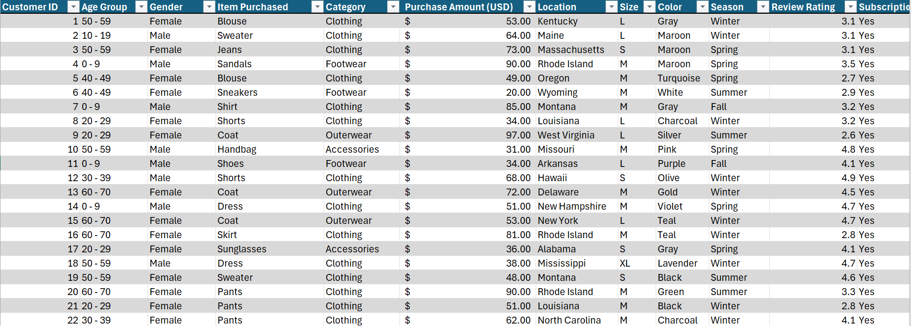
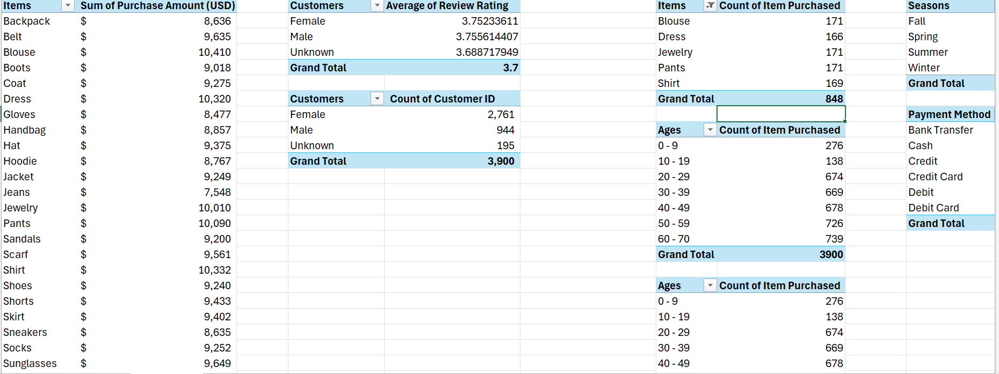
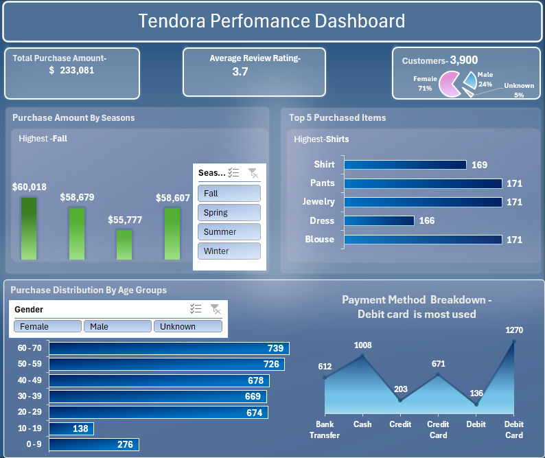

# Trendora Business Performance Analysis

## The Executive Summary
This analysis evaluates Trendora Business Performance Analysis (fall → winter). 
It identifies patterns in Purchase Distribution by Age Group, Purchase Amount by Season, Payment Method Breakdown and highlights key growth drivers as well as areas of concern such as review rating and purchase amount by seasons.

## Business Context
Trendora’s Manager requires a clear data-driven report of the business performance. The objective is to help the team understand this simply, through visualization to identify areas of growth and optimize operations.

## Objectives
This report addresses the following key questions:
- What are the overall Key Performance Indicators (KPIs)?
- Which  top 5 items are driving sales and what Season hosts the highest Purchase amount?
- What are the preferred payment channels for customers?
- What are the Customer demographics ?(Purchase Distribution by Age Group Customer Distribution by Gender)

 ## Data Overview
The dataset contain 3,900 transactions  and 17 columns which formed the basis of the analysis. Covering Fall to Winter. It represents customer orders and totals purchase amounts.

## Key Findings
- The business generated $233,081 in total sales revenue.
- Customer satisfaction is moderate with an average rating of 3.7.
- Female customers represent the largest customer segment, accounting for 71% of all customers.
- Pants, Jewelry, and Blouses are the top-selling products with equal distribution.
- Older age groups drive most purchases, with customers aged 60-70 years recording the highest purchase volume, followed by the 50-59 age group.
- Fall is the best-performing season, generating the highest sales revenue while Summer recorded the lowest revenue.
Debit Card is the preferred payment method, followed by Cash, showing a strong preference for convenient payment options.

## Dashboard ​‌

## download Excel worksheet
click the link to access the live Report : 

## [please open the downloaded worksheet in Microsoft Excel to interact with the dashboard ](trendora_data_analysis.xlsx)

## Data Cleaning and Transformation
- Removed duplicate entries from the entire dataset.
- Identified and handled null values from the Discount value by understanding the relationship with the Promo Code Used table.
- Handled null values and standardized the Gender column by creating a new column and using the IF function.
- Grouped customer ages into age ranges as well as gender for demographic analysis.

 ## Detailed Findings & Analysis
### Key Performance Indicators 
- Trendora generated a total purchase amount of $233,081 from 3,900 customers, with an average review rating of 3.7/5, Indicating strong overall sales performance and a moderately positive customer experience.

### Product Performance
- The most purchased products were Pants, Jewelry, and Blouses, with 171 purchases each. This demonstrates strong customer demand for these categories.
- Shirts followed closely with 169 purchases, while Dresses recorded 166 purchases.The small gap between the top five products suggests that customer demand is fairly balanced across Trendora's product categories.

 ### Customer Demographics
- Female customers dominate the customer base, accounting for 71% of all customers, while males represent 24%. 
- Customers aged 50-70 years generate the highest purchase volumes, making older adults the most active and valuable customer segment.
  
 ### Seasonal Performance
- Sales remained relatively stable across all seasons; however, Fall generated the highest revenue of $60,018, making it the strongest-performing season.
  
### Customer Payment Method Distribution
- The analysis shows that Debit Card is the most preferred payment method, accounting for 1,270 transactions, followed by Cash with 1,008 transactions.
- The analysis indicates a customer preference for convenient electronic payment options, across all seasons.

## Recommendations
- Continue appealing to Female customers and Focus on marketing efforts or promotions targeting male customers and younger adults to diversify the market reach.
- Gather customer feedback and address common issues to improve Review Rating and  the overall shopping experience.
- Leverage seasonal sales opportunities, especially during fall to maximize revenue.
- Enhance digital payment options considering customer payment preferences.

## Tools Used
Microsoft Excel : For data cleaning, data transformation and visualization.

## Conclusion
Overall, Trendora demonstrates strong sales performance across sales and customer engagement with clear opportunities for future growth. Sales are highest during the fall season, debit cards are the preferred payment method, and purchasing activity is strongest among customers aged 20-70. As the current customer demographic is predominantly female, targeting male customers and younger adults would broaden the company's market reach, increase revenue potential, and contribute to sustained business growth and higher market value.

